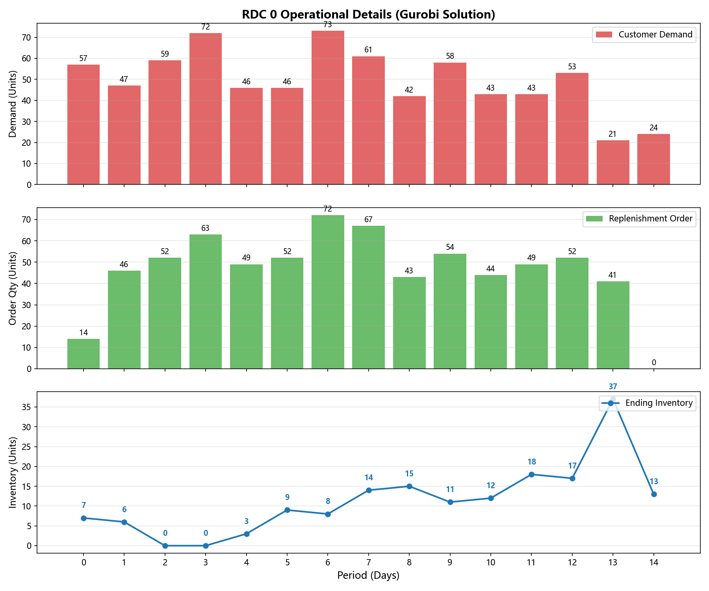
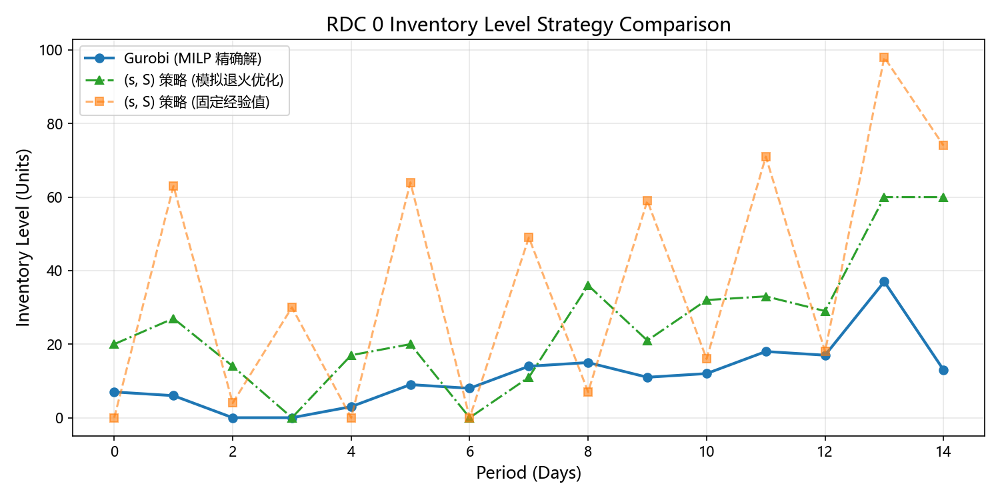
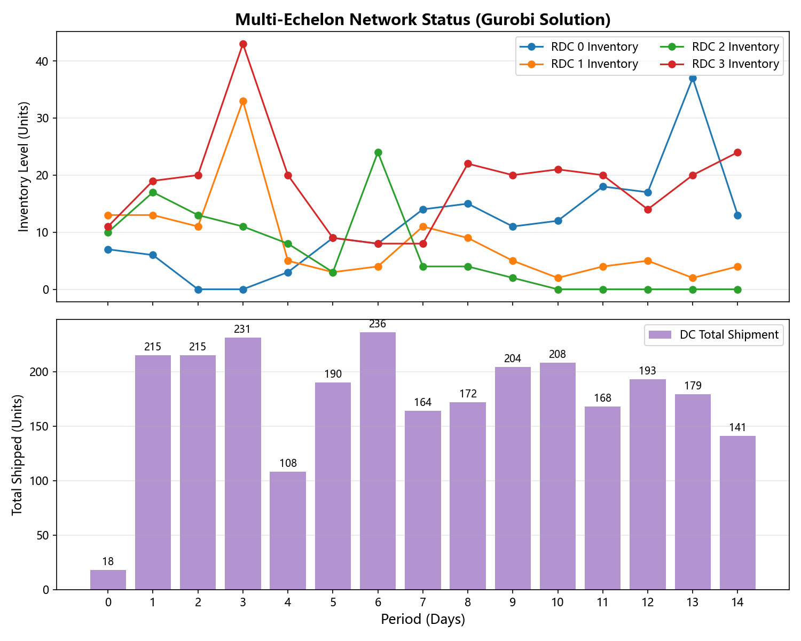

# 多级供应链网络库存优化与不确定性仿真 (Inventory Optimization)

针对多级供应链（中心仓-区域仓）中需求高度不确定的痛点，本项目构建了多周期库存优化模型。项目不仅对比了 **Gurobi 精确求解（MILP）** 与 **模拟退火（SA）优化的 (s, S) 策略**，更引入了**“预测-决策-仿真”**闭环机制，量化了预测偏差对业务利润的真实影响。

## 📌 核心业务场景

*   **网络结构**：1 个中心仓（DC），4 个区域仓（RDC）。
*   **不确定性模拟**：在真实需求上叠加 10% 标准差的正态分布随机噪声，作为算法的**预测数据**。算法只能基于**预测数据**做补货决策，而最终成本由**真实需求**进行结算。
*   **成本结构**：包含单件运输成本、固定发车成本、仓储持有成本以及高昂的缺货惩罚成本。
*   **业务目标**：在避免区域仓物理爆仓的前提下，最小化全网总成本。

## 📁 项目结构 (Project Structure)

```text
inventory-optimization-gurobi-vs-sa/
├── main.py                  # 项目主入口（统筹三种策略的调用与仿真）
├── config.py                # 全局参数配置（网络规模、成本系数、容量限制）
├── data_generator.py        # 数据生成（叠加正态分布噪声生成真实/预测需求）
├── gurobi_solver.py         # 精确求解模块（Gurobi MILP 模型构建）
├── heuristic_solver.py      # 固定经验启发式（传统 (s,S) 策略模拟）
├── metaheuristic_solver.py  # 元启发式模块（模拟退火自动寻优 (s,S) 参数）
├── simulator.py             # 仿真评估模块（基于真实需求重算实际执行成本）
├── visualizer.py            # 可视化模块（生成三张对比图表）
├── requirements.txt         # 第三方依赖清单
├── .gitignore               # Git 忽略规则
├── LICENSE                  # MIT 开源协议
├── README.md                # 本说明文档
└── images/                  # 存放 README 引用的图表
```

## 🚀 快速开始

### 1. 环境依赖

请确保已安装 Python (建议 3.10+)：

```bash
pip install -r requirements.txt
```

### 2. 运行测试

在终端执行主程序：

```bash
python main.py
```
程序将依次输出三种策略的求解过程，并生成三张工业级监控图表。

## 📊 仿真结果与业务洞察

### 1. 微观现场：单节点运营细节联动图（基于 Gurobi 求解结果）

本图以 **第 0 号区域仓（RDC 0）** 为例，展示了 **Gurobi (MILP)** 在“预测偏差”环境下的真实运营细节。

**图表说明**：
*   **横坐标 (Period)**：规划周期（天），共 15 天。
*   **纵坐标 (Units)**：货物数量（件）。
*   **上图（红色柱）**：Customer Demand，当天的**真实**客户需求。
*   **中图（绿色柱）**：Replenishment Order，Gurobi 基于**预测数据**下达的当天补货指令。
*   **下图（蓝色线）**：Ending Inventory，当天结束时的**真实**期末库存量。

**业务洞察与痛点揭示**：
1.  **缺货危机（第 2-3 天）**：由于**预测偏差**的存在，Gurobi 基于预测下达的补货量（绿柱）低于了真实的客户需求（红柱）。导致可用库存被瞬间清空，期末库存跌破安全底线跌至 0，发生了严重的局部缺货（Lost Sales）。
2.  **批量补货与库存积压（第 12-13 天）**：算法为了平衡高昂的固定发车成本，选择了策略性囤货。可以看到在第 13 天，真实需求仅为 21 件，但 Gurobi 的补货计划（绿柱）激增至 **74 件**。这直接导致第 13 天的期末库存飙升到了 **37 件**，并在第 14 天停止补货（绿柱为 0），依靠库存消化需求。



### 2. 核心对战：三种策略的库存水位对比 (RDC 0)

**1. 图表基础信息拆解**

- **标题**：RDC 0 Inventory Level Strategy Comparison（0号区域仓的库存水位策略对比）。
- **横坐标 (X轴)**：Period (Days) —— 规划周期（天）。从第 0 天到第 14 天，共 15 天的业务推演。
- **纵坐标 (Y轴)**：Inventory Level (Units) —— 库存水位（件）。代表每天结束时，仓库里真实剩下的货物数量。
- **图例 (Legend)**：包含三种策略，分别用蓝、绿、橙三条线表示。

**2. 三条曲线的深度剖析**

**🔵 蓝线（实线+圆点）：Gurobi (MILP 精确解)**
- 代表什么：工业级的全局最优解。它看着预测数据，统筹了全网运力、仓储费和发车费，算出了最完美的计划。
- 为什么走势最平稳：Gurobi 通过批量订货把固定发车成本摊薄，库存水位常年压在 10~20 左右的低位。
- 图中的异常点（第2、3天跌至0）：因为 Gurobi 基于预测数据算出的完美计划，遇到了真实需求的突然爆发。预测偏差直接把它的库存击穿到了 0（发生局部缺货）。第 13 天的小高峰（37）则是它为了省发车费做的“批量囤货”。

**🟢 绿线（点划线+三角形）：(s, S) 策略 (模拟退火优化)**
- 代表什么：数据驱动的智能规则。模拟退火（SA）算法，通过自动寻优，找到了最佳的触发点（比如 s=56, S=77）。
- 为什么呈锯齿状：因为 (s, S) 策略的基因就是“跌破底线才补货”。只要库存掉到 56，就补到 77。这种被动响应的机制，导致它必然会一高一低。但由于参数找得好，它的最高峰值（约60）远低于固定经验。

**🟠 橙线（虚线+方块）：(s, S) 策略 (固定经验值)**
- 代表什么：传统的人工拍脑袋决策（比如老厂长定的 s=40, S=110）。
- 为什么走势像“过山车”：由于参数设置极不合理，它不仅补货滞后，而且一补就补到满仓（100以上）。这导致了极高的库存积压（仓储费飙升）。一旦遭遇需求波动，它又反应迟钝，导致断货。这是成本最高、最差的管理方式。



### 3. 宏观统筹：多级网络全局协同图 (基于 Gurobi 求解)

本图展示了 1 个中心仓（DC）与 4 个区域仓（RDC 0-3）在 15 天内的全局库存联动与运力分配。

*   **横坐标**：规划周期（天）；**纵坐标**：货物数量（件）。
*   **上半部分（多色折线）**：代表 4 个区域仓各自的真实期末库存水位。
*   **下半部分（紫色柱状图）**：代表中心仓每日向全网发出的**总补货量**。

**💡 核心业务洞察：**
1.  **差异化的节点策略**：不同颜色的折线走势完全不同（如 RDC 3 在第 3 天因预测偏差出现库存尖峰，而 RDC 0 在第 13 天才出现批量补货）。
2.  **运力削峰填谷（Capacity Constraint）**：请看下半部分的紫柱，中心仓每日的总发货量在 250 件以内，避免运力拥堵。

*(这张图证明了模型具备全局网络流（Network Flow）的统筹能力，这也是高级 APS 系统最核心的底层逻辑。)*


### 📊 核心数据深度剖析 (Data Analysis)

通过对比终端输出的“理论预测成本”与“仿真真实成本”，得出以下结论：

| 求解策略 | 理论预测成本 (基于预测数据) | 真实执行成本 (基于真实需求) | 预测偏差导致的成本上升 |
| :--- | :--- | :--- | :--- |
| **Gurobi MILP** | 8025.00 元 | **10701.00 元** | **+ 2676.00 元 (+33.35%)** |
| **固定 (s,S)** | 18280.50 元 | **19900.50 元** | + 1620.00 元 (+8.86%) |
| **SA 优化 (s,S)** | - (依靠仿真评估) | **10953.50 元** | - |

**1. 为什么 Gurobi 的真实成本比预测成本高了 33.35%？**
Gurobi 是基于预测数据做出的“极致最优计划”。当真实需求发生波动时，由于它把资源（安全库存、运力）压榨到了极限，缺乏缓冲，导致了极高的缺货罚款。这证明了在工业界，“数学上的绝对最优”往往在现实中是“脆弱的”。

**2. SA 搜索轨迹的业务意义**
日志显示，模拟退火将 (s, S) 参数从初始的随机值一路进化到了 `(s=56, S=77)`，真实成本从 21889.50 元一路降到了 10953.50 元。这证明了：**数据驱动的参数自动寻优，绝对碾压人工经验**。即便在预测有偏差的恶劣环境下，SA 依然将成本压在了比固定规则（19900.50 元）低 **44.96%** 的水位。

**3. 最终的业务抉择：Gurobi 还是 SA？**
真实成本对比：Gurobi (10701.00) < SA (10953.50) < 固定经验 (19900.50)。
虽然 Gurobi 赢了，但 SA 仅落后 **2.36%**。在真实的供应链场景中，SA 具有极低的算力消耗、极强的可解释性，且不会因为上游预测模型的崩溃而全盘皆输。**SA + (s,S) 规则，是应对真实动荡市场的最强兜底方案。**

## 💡 核心工程洞察与业务反思 (Engineering & Business Insights)

本项目的核心不仅在于代码实现，更在于探究不同算法在“不确定性”环境下的边界：

**1. 基于预测的全局寻优 vs 基于规则的被动响应**
* **Gurobi (MILP)** 和 **固定 (s,S) 策略** 均是基于当期的“预测数据”来推导未来的调度计划。
* **模拟退火 (SA)** 则扮演了“参数调优器”的角色。它通过离线仿真迭代（叠加预测偏差与真实需求），搜索出全局最优的 `(s, S)` 阈值，作为未来的调度规则。

**2. 理论最优 vs 实际鲁棒性（业务妥协）**
* 仿真结果显示，Gurobi 在真实成本结算下依然达到了理论最优（**10701.00 元**），而 SA 优化策略（**10953.50 元**）仅差 **2.36%**；传统的固定经验策略（**19900.50 元**）呈现出断崖式的成本劣势。
* **业务反思**：在真实生产中，Gurobi 基于预测算出的“数学最优计划”未必是“业务最优”。因为它过度依赖预测的准确性，且计划极其精细，导致抗风险能力（鲁棒性）较差，业务员也难以干预。
* **落地选择**：SA 优化出的 `(s, S)` 规则虽然牺牲了微小成本，但其具备极强的**可解释性**和**抗风险能力**。在突发极端场景下（如预测发生灾难性偏差时），简单规则反而可能比复杂精确计划表现得更稳健。实际工作中，没有绝对的“最好算法”，只有基于“算力、时效、业务可解释性”的工程妥协。

## ⚖️ License 与 第三方依赖声明

### License

本仓库的项目基于 [MIT LICENSE](./LICENSE) 开源。

### 第三方依赖声明

本仓库项目依赖的第三方库均遵循其各自的许可协议。用户需自行通过 `pip install -r requirements.txt` 安装，本项目不直接分发上述库的源码或二进制文件。具体包括：

- **开源库**：包括但不限于NumPy (BSD License)、Matplotlib (Matplotlib License) 等，均遵循其各自的开源许可证。

- **商业求解器**：本项目使用了 Gurobi 及其 Python 接口 gurobipy。Gurobi 属于商业闭源软件，本项目在测试时使用的是官方提供的 Size-Limited 免费受限版。使用者需自行前往 Gurobi 官网注册并获取对应的 License 才能运行相关代码。本项目不承担任何因使用 Gurobi 产生的版权或商业授权纠纷。